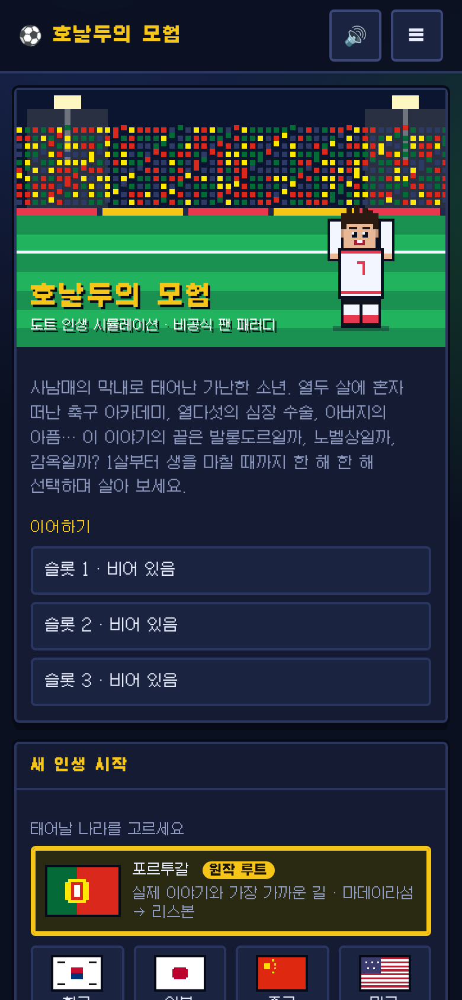
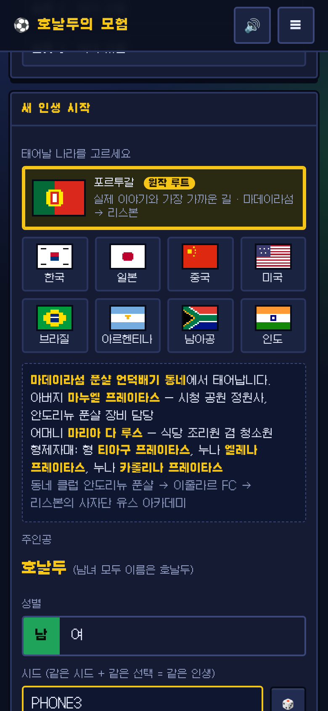
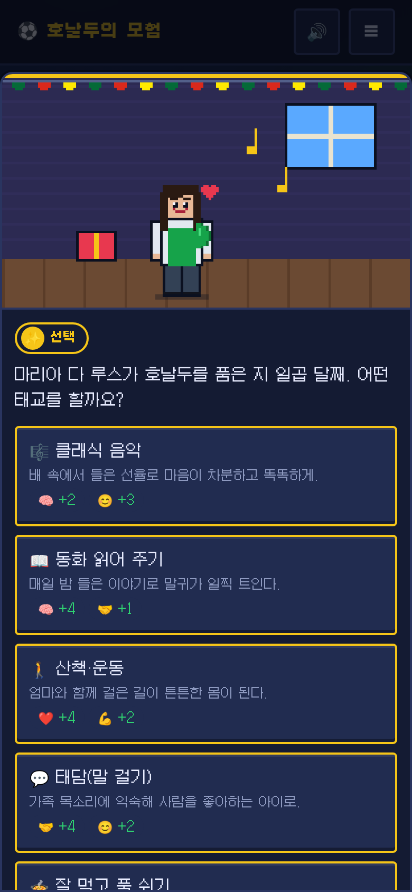
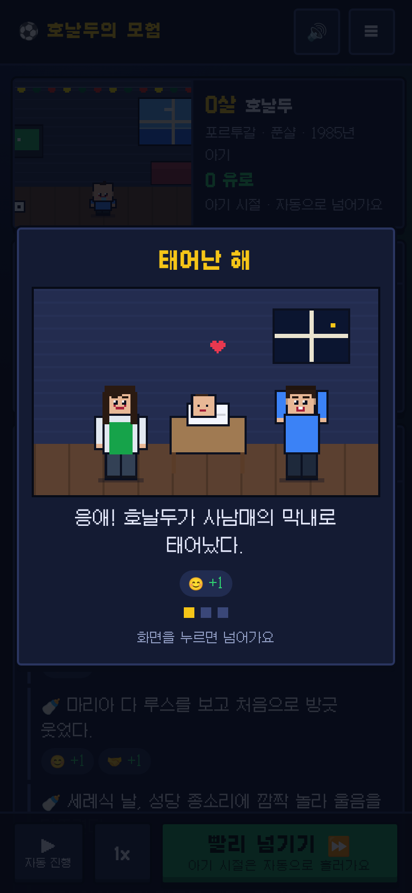
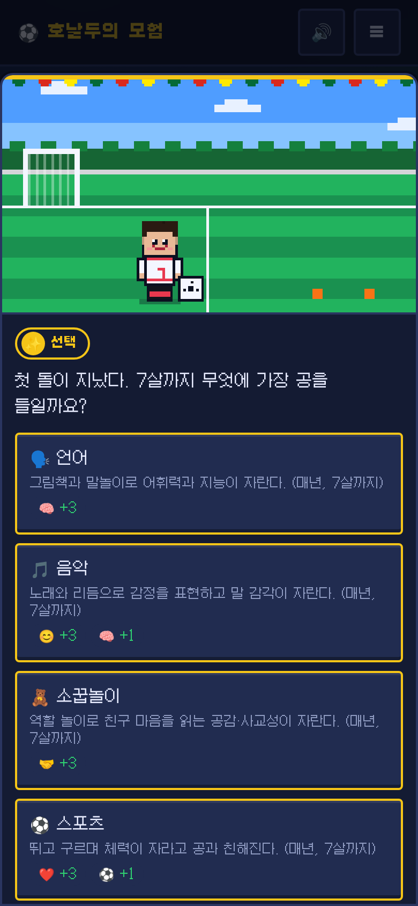
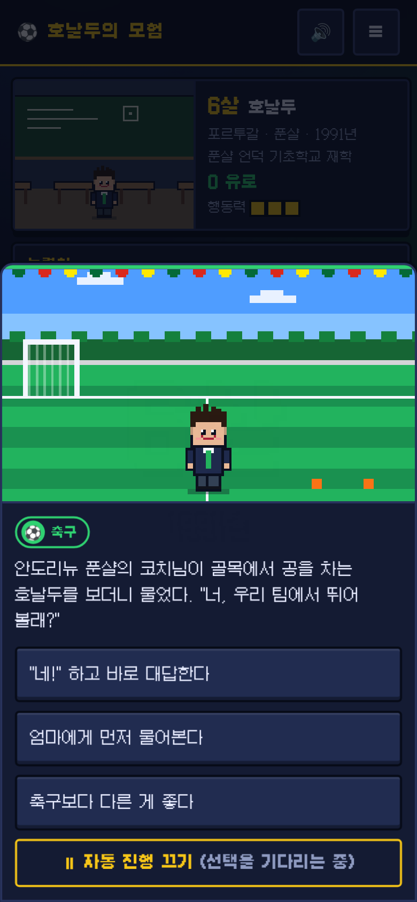
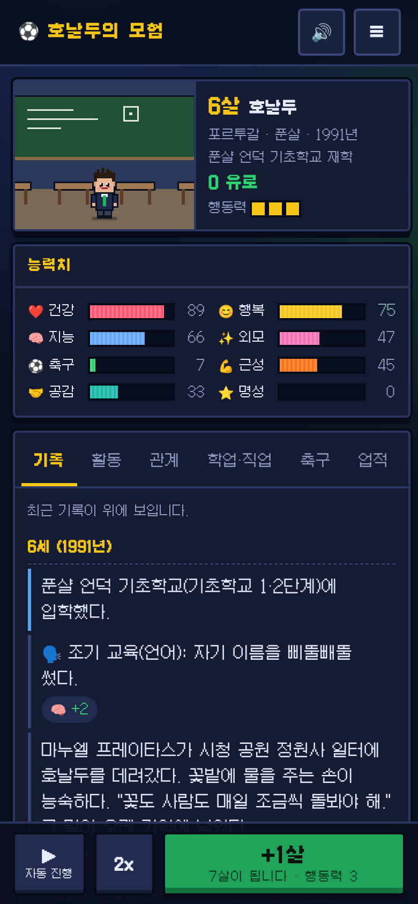
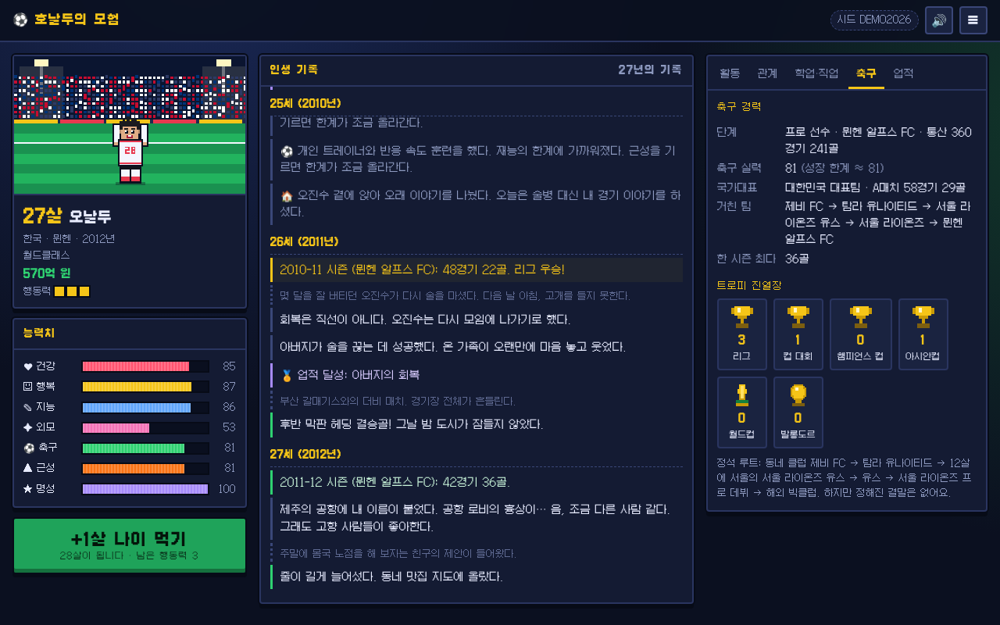
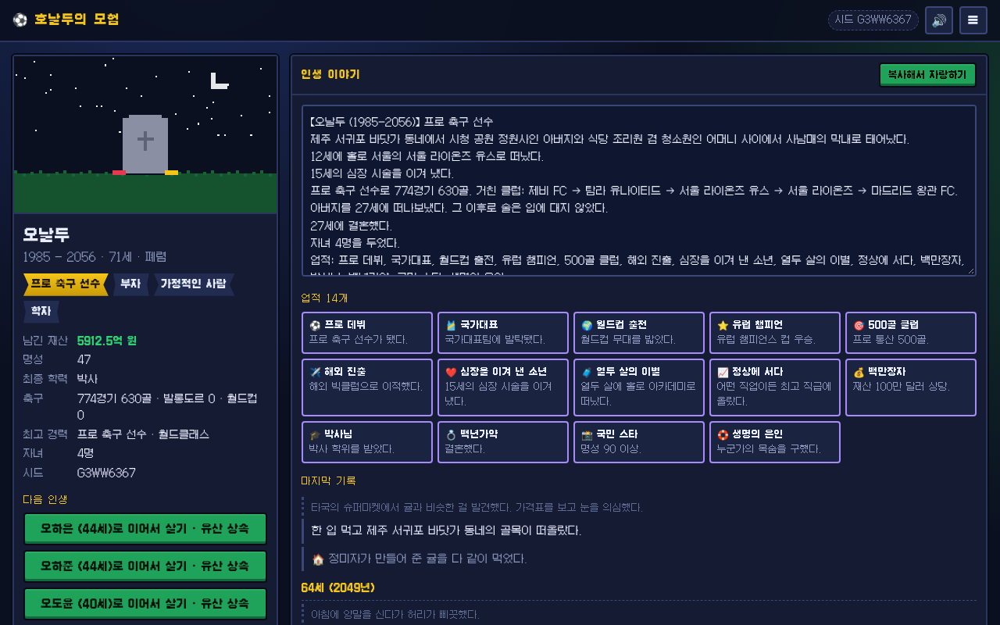

# 인생게임

## v2 화면 개편 · 첫 번째 조각

새 인생 시작 → 건너뛸 수 있는 환생 이야기 → 부모·집과 아이·미리보기의 세 단계로 시작합니다. 원작·무작위·직접 설정, 부모별·항목별 다시 굴리기와 출생 전 기회·압박 미리보기를 제공합니다.

첫 화면은 **올해**입니다. 처리할 결정, 사람의 상태, 올해의 행동 세 칸을 확인하고 **+1살**을 누르세요. 남은 행동을 버리기 전 한 번 알려 줍니다. 다른 활동과 진로는 **나**에서도 볼 수 있습니다.

아기 장면은 기본적으로 **다음 장면**을 눌러 읽습니다. 장면 안의 **자동 넘김**을 켜면 자동으로 흐릅니다. 큰 순간은 별도로 표시되고 **연대기**에 남습니다. 축구의 승리에는 글자로도 SIUUU!가 보이며 슬픈 순간에는 축하 효과가 없습니다.

메뉴의 **글자·움직임·소리 설정**에서 글자 크기 세 단계, 움직임 줄이기, 소리, 오프닝 항상 건너뛰기를 바꿀 수 있습니다. 아래의 이전 기능 소개 중 화면 위치와 자동 넘김 설명은 이 절을 우선합니다.

도트(픽셀) 그림으로 된 인생 시뮬레이션 게임입니다. 가난한 집 사남매의 막내로 태어난 "호날두 같은" 주인공의 삶을 1살부터 생을 마칠 때까지 한 해씩 살아 봅니다.

## 어떤 게임인가요?

- 처음에 태어날 나라를 고릅니다. 맨 위의 포르투갈은 실제 이야기와 가장 가까운 "원작 루트"이고, 한국, 일본, 중국, 미국, 브라질, 아르헨티나, 남아공, 인도도 고를 수 있습니다. 나라마다 가족 이름, 동네, 부모님 직업, 학교 제도, 음식, 명절, 돈 단위, 축구 문화가 그 나라에 맞게 바뀝니다.
- 새 인생을 시작할 때 캐릭터 이름을 정합니다(최대 20자, 비우면 "호날두"). 진행 중에도 ☰ 메뉴의 "✏️ 이름 바꾸기"에서 바꿀 수 있으며, 기록·저장 슬롯·인생 결산에 새 이름이 적용됩니다. 기존 저장은 "호날두"로 이어집니다.
- 태어날 때 몸이 무작위로 정해집니다(예상 키, 체격, 반사신경, 지구력, 유연성, 손재주, 목소리). 태교로 타고난 재능(음악, 미술, 운동 감각, 논리·수리, 언어, 미각·요리, 끼·무대)이 달라지고, 돌이 지나면 7살까지의 조기 교육(언어·음악·소꿉놀이·스포츠·미술·논리·요리)으로 재능을 더 키웁니다. 몸과 재능은 능력치 아래 "🧬 타고난 몸 · 재능"에서 볼 수 있습니다. 0~4살 아기 시절은 큼직한 그림 카드가 사진첩처럼 자동으로 넘어갑니다(화면을 누르면 빨리 넘어가요).
- 다섯 살부터는 해마다 활동(공부, 운동, 축구 연습, 데이트, 아르바이트, 여행, 투자, 범죄 등)을 고르고 "+1살 나이 먹기"를 누릅니다. 그러면 그해의 사건이 일어나고, 고르는 답에 따라 인생이 달라집니다. 어떤 선택은 몇 년 뒤에 결과가 돌아옵니다.
- 인생은 언제나 하나의 "길(루트)" 위에 있습니다. 중학교·고등학교에서 진학반, 문과, 이과, 예체능(미술·음악·연기·체육특기생), 기획사 연습생, 조리·기술 특성화 같은 트랙을 고르면 그 트랙이 여는 길로 이어집니다. 법조계, 의료계, 미술계, 모델계, 아이돌, 가수, 밴드, 배우, 개그맨, 요식업, 격투가, 축구·농구·야구 선수, 그리고 직장인·공무원·교사·개발자·장사·농어업·군인·경찰·정치·과학·종교·뒷골목·도박꾼까지 44가지 길이 있습니다. 길마다 입문부터 정점, 쇠퇴와 은퇴까지 단계가 있고, 그 길의 사건만 일어납니다. 길은 실패, 방출, 부상, 은퇴, 번아웃, 스캔들, 해체, 또는 갈림길에서의 내 선택으로만 바뀌고, 다음 길도 그럴듯한 곳으로 이어집니다(은퇴한 선수 → 코치·해설가·식당, 해체한 아이돌 → 배우·솔로·보컬 트레이너, 의사 → 교수·개원). "학업·직업" 탭에서 지금 길과 단계, 다음 단계 조건, 나갈 수 있는 곳을 볼 수 있습니다.
- 축구 선수가 되는 길이 가장 깊게 만들어져 있습니다. 동네 클럽에서 시작해 열두 살에 혼자 큰 도시 아카데미로 떠나고, 프로 데뷔, 해외 이적, 국가대표, 월드컵, 발롱도르까지 이어집니다. 하지만 정해진 결말은 없습니다. 의사, 농부, 아이돌, 프로그래머, 요리사, 군인, 대통령, 우주비행사, 스님, 범죄자 등 150가지가 넘는 직업 중 무엇이든 될 수 있습니다.
- 해마다 "올해의 결정"이 있습니다(어린이 1번 이상, 십대 2~3번, 어른 1~2번). 착한 길만 있는 게 아닙니다. 장난, 거짓말, 싸움, 땡땡이 같은 악동 선택도 있고, 잘 풀릴 때도 있지만 정학·퇴학·전과·파산으로 이어질 수도 있습니다. 위험한 답에는 "⚠️ 위험한 선택" 표시가 붙습니다.
- 오락실 뽑기에서 시작해 토토, 경마, 카지노로 이어지는 도박 길이 있습니다. 내기는 이길 확률과 배당이 미리 보입니다. 도박 중독이 2단계에 이르면 "겜블러" 직업이 열리고, 빚, 사채, 가족의 만류, 치료와 재발 같은 일도 생깁니다. 악동 기질, 평판, 도박, 음주, 전과는 능력치 아래 "특성" 줄에 표시됩니다.
- 13~14살, 16~17살, 19~20살에 진로를 고민하고 결정합니다. ☰ 메뉴의 "🧭 진로"에서 지금 열린 길과 잠긴 길, 그리고 여는 방법을 볼 수 있습니다. 겜블러, 야바위꾼, 심마니, 스트리머, 기수, 대리기사 같은 특이한 직업 17가지가 추가됐습니다.
- 생을 마치면 성공 또는 실패 엔딩(길마다 성공·실패 엔딩이 있어 100가지가 넘습니다)이 나옵니다. 본 엔딩은 "📖 엔딩 도감"에 모입니다. 칭호, 업적, 인생 이야기도 나옵니다.
- 인생 이야기는 복사해서 친구에게 자랑할 수 있습니다. 자녀가 있으면 유산을 물려받아 자녀의 삶을 이어 갈 수 있습니다.
- 같은 "시드"로 다시 시작하고 같은 선택을 하면 똑같은 인생이 펼쳐집니다.

## 하는 법 (설치 필요 없음)

1. 이 페이지 위쪽의 초록색 "Code" 버튼을 누르고 "Download ZIP"을 고릅니다.
2. 내려받은 ZIP 파일의 압축을 풉니다. 윈도는 마우스 오른쪽 버튼에서 "압축 풀기", 맥은 더블클릭하면 됩니다.
3. 압축을 푼 폴더 안의 `index.html`을 더블클릭합니다. 크롬, 엣지, 사파리, 파이어폭스 같은 웹 브라우저에서 바로 실행됩니다.

인터넷 연결도, 프로그램 설치도 필요 없습니다. 휴대폰 브라우저에서도 할 수 있습니다.

### 휴대폰에서

- 세로 화면에 맞춰 만들었습니다. 중요한 버튼(+1살, 자동 진행, 선택지)은 엄지손가락이 닿는 화면 아래쪽에 있습니다.
- 인터넷 주소(웹 서버)로 열면 "홈 화면에 추가"해 앱처럼 전체 화면으로 쓸 수 있습니다.

### 조작

- 활동 탭에서 버튼을 누르면 그 일을 합니다. 한 해에 3번(행동력 3)까지 할 수 있습니다.
- "+1살" 버튼(또는 Enter 키)을 누르면 한 해가 지나갑니다.
- "▶ 자동 진행"을 켜면 해마다 저절로 넘어가고, 무언가를 골라야 할 때만 멈춥니다. 1x/2x로 속도를 바꾸고, 언제든 다시 눌러 끌 수 있습니다.
- 골, 우승, 승진 같은 큰 순간에는 "시우!" 소리가 납니다.
- 사건 창이 뜨면 답을 고르세요. "성공률"이 적힌 답은 능력치가 높을수록 잘 됩니다.
- 해마다 자동 저장됩니다. 오른쪽 위 ☰ 메뉴에서 저장 슬롯 3개를 관리할 수 있습니다. 🔊 버튼으로 소리를 끄고 켭니다.

## 화면

| 시작 (원작 루트) | 태교 고르기 | 아기 시절 카드 |
|---|---|---|
|  |  |  |

| 조기 교육 | 사건 카드 (자동 진행 중) | 게임 화면 |
|---|---|---|
|  |  |  |

| 데스크톱: 프로 축구 선수 | 데스크톱: 인생 결산 |
|---|---|
|  |  |

## 알려 드립니다 (면책)

- 이 게임은 비공식 팬 패러디입니다. 크리스티아누 호날두 본인이나 그 가족, 어떤 축구 구단, 리그, 협회, 스폰서와도 관계가 없고 승인받지 않았습니다.
- 게임에 나오는 구단, 학교, 대학, 회사 이름은 모두 지어낸 이름입니다. 실제 구단의 로고나 상표는 쓰지 않았습니다.
- 주인공의 가족 이야기는 공개된 사실에서 영감을 받았지만, 나라별로 새로 꾸민 허구입니다.
- 그림과 효과음은 코드로 직접 만들었고, "시우!" 소리(assets/audio/siuu.mp3)는 프로젝트에 포함된 효과음입니다. 글꼴은 Galmuri(SIL Open Font License 1.1)이며 라이선스 파일은 `assets/fonts/OFL-Galmuri.txt`에 있습니다.

## 개발자용

- 빌드 과정이나 외부 라이브러리가 없습니다. 순수 HTML/CSS/JavaScript입니다.
- 테스트: `npm test` (Node 18 이상의 내장 테스트 도구 `node --test`를 씁니다).
- 데이터 검사: `node tools/validate-data.js`
- 설계 문서, 데이터 형식, 이벤트·직업·나라 추가 방법은 [docs/DESIGN.md](docs/DESIGN.md)에 있습니다.
- 길(루트) 구조와 새 길을 추가하는 방법은 DESIGN.md의 §2f와 §5 "Add a route"에 있습니다. 데이터 검사기와 `test/routes.test.js`가 길 규칙(길마다 출구 선언, 길 밖 사건 금지, 나이에 안 맞는 사건 금지)을 지키는지 확인합니다.
