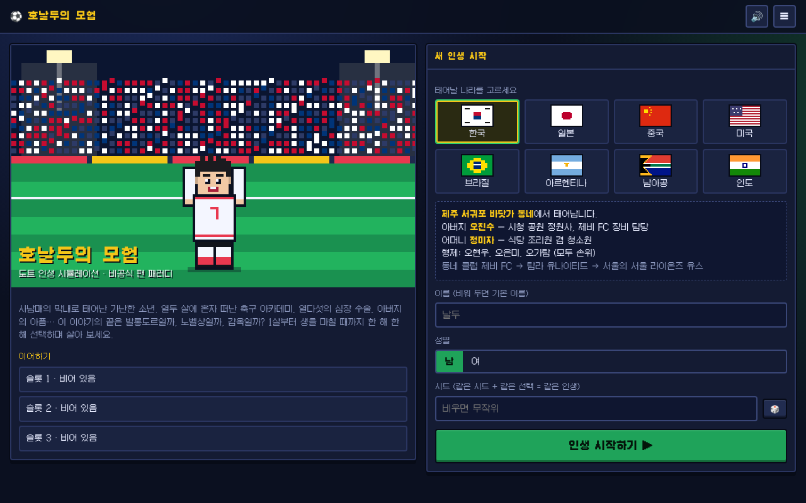
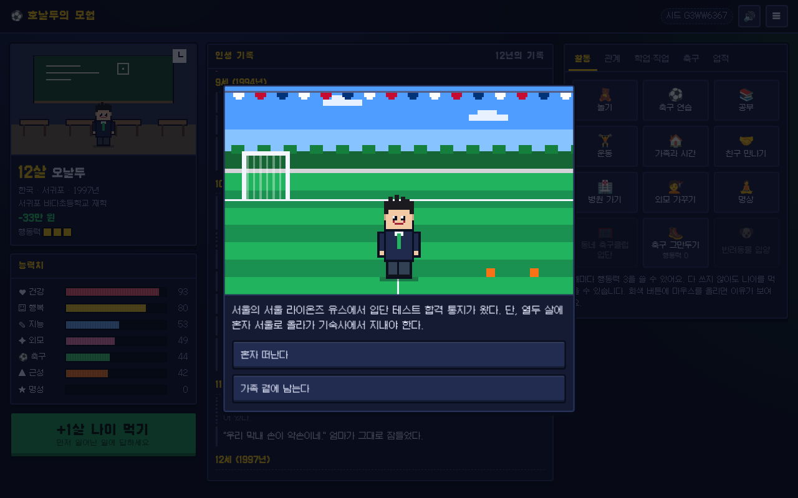
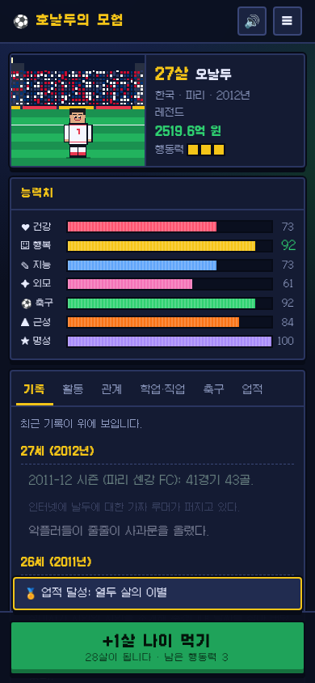
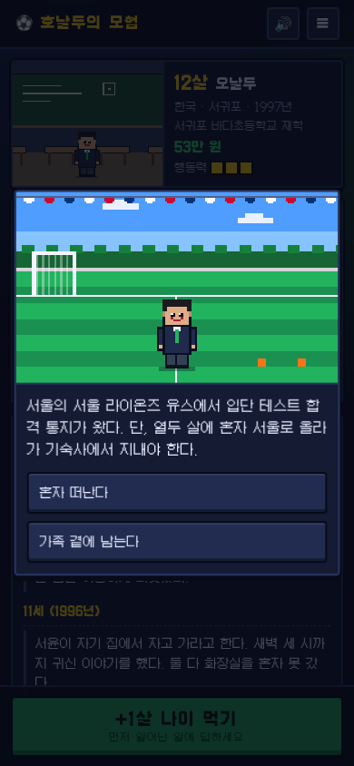
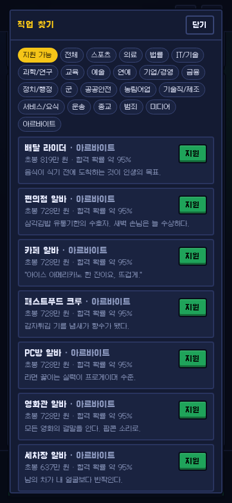

# 호날두의 모험 (Ronaldo's Adventure)

도트(픽셀) 그림으로 된 인생 시뮬레이션 게임입니다. 가난한 집 사남매의 막내로 태어난 "호날두 같은" 주인공의 삶을 1살부터 생을 마칠 때까지 한 해씩 살아 봅니다.

## 어떤 게임인가요?

- 처음에 태어날 나라를 고릅니다. 한국, 일본, 중국, 미국, 브라질, 아르헨티나, 남아공, 인도 중 하나입니다. 나라마다 가족 이름, 동네, 부모님 직업, 학교 제도, 음식, 명절, 돈 단위, 축구 문화가 그 나라에 맞게 바뀝니다.
- 해마다 활동(공부, 운동, 축구 연습, 데이트, 아르바이트, 여행, 투자, 범죄 등)을 고르고 "+1살 나이 먹기"를 누릅니다. 그러면 그해의 사건이 일어나고, 고르는 답에 따라 인생이 달라집니다. 어떤 선택은 몇 년 뒤에 결과가 돌아옵니다.
- 축구 선수가 되는 길이 가장 깊게 만들어져 있습니다. 동네 클럽에서 시작해 열두 살에 혼자 큰 도시 아카데미로 떠나고, 프로 데뷔, 해외 이적, 국가대표, 월드컵, 발롱도르까지 이어집니다. 하지만 정해진 결말은 없습니다. 의사, 농부, 아이돌, 프로그래머, 요리사, 군인, 대통령, 우주비행사, 스님, 범죄자 등 150가지가 넘는 직업 중 무엇이든 될 수 있습니다.
- 생을 마치면 칭호, 업적, 인생 이야기가 나옵니다. 인생 이야기는 복사해서 친구에게 자랑할 수 있습니다. 자녀가 있으면 유산을 물려받아 자녀의 삶을 이어 갈 수 있습니다.
- 같은 "시드"로 다시 시작하고 같은 선택을 하면 똑같은 인생이 펼쳐집니다.

## 하는 법 (설치 필요 없음)

1. 이 페이지 위쪽의 초록색 "Code" 버튼을 누르고 "Download ZIP"을 고릅니다.
2. 내려받은 ZIP 파일의 압축을 풉니다. 윈도는 마우스 오른쪽 버튼에서 "압축 풀기", 맥은 더블클릭하면 됩니다.
3. 압축을 푼 폴더 안의 `index.html`을 더블클릭합니다. 크롬, 엣지, 사파리, 파이어폭스 같은 웹 브라우저에서 바로 실행됩니다.

인터넷 연결도, 프로그램 설치도 필요 없습니다. 휴대폰 브라우저에서도 할 수 있습니다.

### 조작

- 활동 탭에서 버튼을 누르면 그 일을 합니다. 한 해에 3번(행동력 3)까지 할 수 있습니다.
- "+1살 나이 먹기" 버튼(또는 Enter 키)을 누르면 한 해가 지나갑니다.
- 사건 창이 뜨면 답을 고르세요. "성공률"이 적힌 답은 능력치가 높을수록 잘 됩니다.
- 해마다 자동 저장됩니다. 오른쪽 위 ☰ 메뉴에서 저장 슬롯 3개를 관리할 수 있습니다. 🔊 버튼으로 소리를 끄고 켭니다.

## 화면

| 사건 선택 | 프로 축구 선수 | 인생 결산 |
|---|---|---|
|  |  |  |

| 휴대폰 화면 | 휴대폰 사건 | 직업 찾기 |
|---|---|---|
|  |  |  |

## 알려 드립니다 (면책)

- 이 게임은 비공식 팬 패러디입니다. 크리스티아누 호날두 본인이나 그 가족, 어떤 축구 구단, 리그, 협회, 스폰서와도 관계가 없고 승인받지 않았습니다.
- 게임에 나오는 구단, 학교, 대학, 회사 이름은 모두 지어낸 이름입니다. 실제 구단의 로고나 상표는 쓰지 않았습니다.
- 주인공의 가족 이야기는 공개된 사실에서 영감을 받았지만, 나라별로 새로 꾸민 허구입니다.
- 그림과 소리는 모두 코드로 직접 만들었습니다. 글꼴은 Galmuri(SIL Open Font License 1.1)이며 라이선스 파일은 `assets/fonts/OFL-Galmuri.txt`에 있습니다.

## 개발자용

- 빌드 과정이나 외부 라이브러리가 없습니다. 순수 HTML/CSS/JavaScript입니다.
- 테스트: `npm test` (Node 18 이상의 내장 테스트 도구 `node --test`를 씁니다).
- 데이터 검사: `node tools/validate-data.js`
- 설계 문서, 데이터 형식, 이벤트·직업·나라 추가 방법은 [docs/DESIGN.md](docs/DESIGN.md)에 있습니다.
